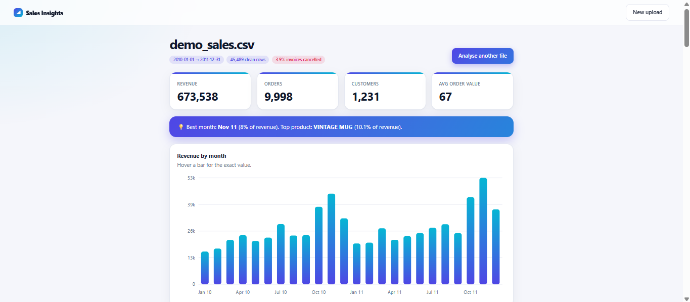

# Arslan Riaz, Portfolio

Personal portfolio of a full-stack Python developer. Plain HTML and CSS with a few lines of JavaScript for the light and dark theme and scroll animations. No framework and no build step.

**Live site:** https://arslan3x5.github.io

## What's on the site
- Hero with availability status and quick links
- Two live projects with screenshots, tech tags, demo links and source code:
  - **Sales Insights**: sales CSV to cleaned data, KPIs, customer segments and a forecast (Django, pandas)
  - **TaskFlow**: kanban task manager with a REST API, tests and CI (Django, PostgreSQL)
- Skills, certificates and a short description of how I work
- Contact section with email, LinkedIn, GitHub and Upwork

## Features
- Responsive layout for phones, tablets and desktops
- Light and dark mode with a saved preference
- Keyboard-friendly, with a skip link and visible focus states
- Respects the reduced-motion setting
- Loads fast: one HTML file, no external libraries or fonts

## Run locally
Open `index.html` in a browser, or in VS Code right-click the file and choose **Open with Live Server** if you have that extension installed.

## Deploy
Hosted free on GitHub Pages from the `main` branch, root folder (**Settings, Pages**).

## Customise
Edit the text directly in `index.html`. Colours and spacing are CSS variables at the top of the file. Screenshots live in `assets/`.

## Contact
arslanriaz785@gmail.com

## License
MIT
